# Diagrama de entidad relación de ETRAL

Generado a partir del esquema SQL entregado para revisión. Muestra las claves primarias, únicas y foráneas y todas las relaciones declaradas con `FOREIGN KEY`; omite atributos no clave para mantener legible el diagrama. Las relaciones con `auth.users` pertenecen al esquema de autenticación de Supabase.

```mermaid
%%{init: {"theme": "base", "look": "classic", "er": {"stroke": "#000000", "fill": "transparent"}, "themeVariables": {"background": "transparent", "primaryColor": "#ffffff", "primaryTextColor": "#000000", "secondaryTextColor": "#000000", "tertiaryTextColor": "#000000", "primaryBorderColor": "#000000", "lineColor": "#000000", "textColor": "#000000", "edgeLabelBackground": "transparent"}}}%%
erDiagram
  MATERIAL_CATEGORIES {
    text id PK
    text name UK
  }
  MEASUREMENT_UNITS {
    text id PK
    text name UK
    text symbol UK
  }
  BRANDS {
    text id PK
    text name UK
  }
  ACTIVITY_TYPES {
    text code PK
    text name UK
  }
  FLOW_STAGES {
    text id PK
    text code UK
  }
  STAGE_ACTIVITIES {
    text id PK
    text stage_id FK
    text activity_type_code FK
  }
  BODY_TYPES {
    text id PK
    text code UK
    text family_id FK
    text brand_id FK
    text output_unit_id FK
  }
  PRODUCT_ROUTES {
    text product_id PK,FK
    text stage_id PK,FK
  }
  INVENTORY_ITEMS {
    text id PK
    text code UK
    text category_id FK
    text unit_id FK
    text brand_id FK
  }
  BOM_ITEMS {
    text id PK
    text body_type_id FK
    text stage_id FK
    text material_code FK
  }
  CECO_ORDERS {
    text id PK
    text ceco UK
    text body_type_id FK
    text stage_id FK
    text customer_id FK
    text production_line_id FK
  }
  STAGE_INVENTORY {
    text id PK
    text stage_id FK
    text ceco FK
  }
  CECO_ACTIVITY_PROGRESS {
    text id PK
    text ceco FK
    text activity_id FK
  }
  OPERATION_LOGS {
    text id PK
    text ceco FK
  }
  WAREHOUSE_EXITS {
    text id PK
    text ticket UK
    text ceco FK
    text material_code FK
  }
  QUALITY_CHECKS {
    text id PK
    text ceco FK
    text stage_id FK
  }
  INVENTORY_MOVEMENTS {
    text id PK
    text code FK
  }
  SIMULATION_RUNS {
    bigint id PK
    uuid created_by FK
  }
  CUSTOMERS {
    text id PK
    text document_number UK
  }
  ORDER_MATERIAL_RESERVATIONS {
    text id PK
    text ceco FK
    text bom_item_id FK
    text stage_id FK
    text material_code FK
  }
  PRODUCT_FAMILIES {
    text id PK
    text name UK
  }
  PRODUCTION_LINES {
    text id PK
    text name UK
  }
  WORK_SHIFTS {
    text id PK
    text code UK
  }
  PERSONNEL {
    text id PK
    text employee_code UK
    text shift_id FK
  }
  EQUIPMENT {
    text id PK
    text code UK
    text stage_id FK
  }
  WORK_CALENDAR {
    text id PK
    date calendar_date UK
  }
  RESOURCE_ASSIGNMENTS {
    text id PK
    text personnel_id FK
    text ceco FK
    text activity_id FK
  }
  OPERATIONAL_INCIDENTS {
    text id PK
    text stage_id FK
    text ceco FK
    text equipment_id FK
  }
  AUTH_USERS {
    uuid id PK
  }

  FLOW_STAGES ||--o{ STAGE_ACTIVITIES : "1:N por stage_id"
  ACTIVITY_TYPES ||--o{ STAGE_ACTIVITIES : "1:N por activity_type_code"
  PRODUCT_FAMILIES o|--o{ BODY_TYPES : "1:N por family_id"
  BRANDS o|--o{ BODY_TYPES : "1:N por brand_id"
  MEASUREMENT_UNITS o|--o{ BODY_TYPES : "1:N por output_unit_id"
  BODY_TYPES ||--o{ PRODUCT_ROUTES : "1:N por product_id"
  FLOW_STAGES ||--o{ PRODUCT_ROUTES : "1:N por stage_id"
  MATERIAL_CATEGORIES o|--o{ INVENTORY_ITEMS : "1:N por category_id"
  MEASUREMENT_UNITS o|--o{ INVENTORY_ITEMS : "1:N por unit_id"
  BRANDS o|--o{ INVENTORY_ITEMS : "1:N por brand_id"
  BODY_TYPES ||--o{ BOM_ITEMS : "1:N por body_type_id"
  FLOW_STAGES o|--o{ BOM_ITEMS : "1:N por stage_id"
  INVENTORY_ITEMS ||--o{ BOM_ITEMS : "1:N por material_code"
  BODY_TYPES ||--o{ CECO_ORDERS : "1:N por body_type_id"
  FLOW_STAGES o|--o{ CECO_ORDERS : "1:N por stage_id"
  CUSTOMERS o|--o{ CECO_ORDERS : "1:N por customer_id"
  PRODUCTION_LINES o|--o{ CECO_ORDERS : "1:N por production_line_id"
  FLOW_STAGES ||--o{ STAGE_INVENTORY : "1:N por stage_id"
  CECO_ORDERS ||--o{ STAGE_INVENTORY : "1:N por ceco"
  STAGE_ACTIVITIES ||--o{ CECO_ACTIVITY_PROGRESS : "1:N por activity_id"
  CECO_ORDERS ||--o{ CECO_ACTIVITY_PROGRESS : "1:N por ceco"
  CECO_ORDERS ||--o{ OPERATION_LOGS : "1:N por ceco"
  INVENTORY_ITEMS ||--o{ WAREHOUSE_EXITS : "1:N por material_code"
  CECO_ORDERS o|--o{ WAREHOUSE_EXITS : "1:N por ceco"
  FLOW_STAGES ||--o{ QUALITY_CHECKS : "1:N por stage_id"
  CECO_ORDERS ||--o{ QUALITY_CHECKS : "1:N por ceco"
  INVENTORY_ITEMS ||--o{ INVENTORY_MOVEMENTS : "1:N por code"
  AUTH_USERS o|--o{ SIMULATION_RUNS : "1:N por created_by"
  BOM_ITEMS o|--o{ ORDER_MATERIAL_RESERVATIONS : "1:N por bom_item_id"
  FLOW_STAGES o|--o{ ORDER_MATERIAL_RESERVATIONS : "1:N por stage_id"
  INVENTORY_ITEMS ||--o{ ORDER_MATERIAL_RESERVATIONS : "1:N por material_code"
  CECO_ORDERS ||--o{ ORDER_MATERIAL_RESERVATIONS : "1:N por ceco"
  WORK_SHIFTS o|--o{ PERSONNEL : "1:N por shift_id"
  FLOW_STAGES ||--o{ EQUIPMENT : "1:N por stage_id"
  PERSONNEL ||--o{ RESOURCE_ASSIGNMENTS : "1:N por personnel_id"
  CECO_ORDERS ||--o{ RESOURCE_ASSIGNMENTS : "1:N por ceco"
  STAGE_ACTIVITIES ||--o{ RESOURCE_ASSIGNMENTS : "1:N por activity_id"
  FLOW_STAGES ||--o{ OPERATIONAL_INCIDENTS : "1:N por stage_id"
  CECO_ORDERS o|--o{ OPERATIONAL_INCIDENTS : "1:N por ceco"
  EQUIPMENT o|--o{ OPERATIONAL_INCIDENTS : "1:N por equipment_id"
```

**Alcance:** 28 tablas de `public` y 40 claves foráneas declaradas. `simulation_runs` está definida en el esquema, pero la interfaz actual no guarda sus corridas allí.

**Tipos físicos presentes:** 40 relaciones `1:N` y 0 relaciones `1:1`. Una relación `1:N` se lee `N:1` desde la tabla hija hacia la padre. Una clave foránea única en la hija produciría `1:1`.

**Lectura de mínimos:** `||` junto a la tabla padre significa que cada fila hija requiere exactamente un padre; `o|` significa que la clave foránea admite `NULL` y la hija puede tener cero o un padre. `o{` junto a la hija significa que un padre puede tener cero o muchas filas hijas.

| Tabla padre | Tabla hija | Clave foránea hija → padre | Tipo padre → hija | Referencia en la hija |
|---|---|---|---|---|
| `public.flow_stages` | `public.stage_activities` | `stage_id` → `id` | **1:N** | Obligatoria (1) |
| `public.activity_types` | `public.stage_activities` | `activity_type_code` → `code` | **1:N** | Obligatoria (1) |
| `public.product_families` | `public.body_types` | `family_id` → `id` | **1:N** | Opcional (0..1) |
| `public.brands` | `public.body_types` | `brand_id` → `id` | **1:N** | Opcional (0..1) |
| `public.measurement_units` | `public.body_types` | `output_unit_id` → `id` | **1:N** | Opcional (0..1) |
| `public.body_types` | `public.product_routes` | `product_id` → `id` | **1:N** | Obligatoria (1) |
| `public.flow_stages` | `public.product_routes` | `stage_id` → `id` | **1:N** | Obligatoria (1) |
| `public.material_categories` | `public.inventory_items` | `category_id` → `id` | **1:N** | Opcional (0..1) |
| `public.measurement_units` | `public.inventory_items` | `unit_id` → `id` | **1:N** | Opcional (0..1) |
| `public.brands` | `public.inventory_items` | `brand_id` → `id` | **1:N** | Opcional (0..1) |
| `public.body_types` | `public.bom_items` | `body_type_id` → `id` | **1:N** | Obligatoria (1) |
| `public.flow_stages` | `public.bom_items` | `stage_id` → `id` | **1:N** | Opcional (0..1) |
| `public.inventory_items` | `public.bom_items` | `material_code` → `code` | **1:N** | Obligatoria (1) |
| `public.body_types` | `public.ceco_orders` | `body_type_id` → `id` | **1:N** | Obligatoria (1) |
| `public.flow_stages` | `public.ceco_orders` | `stage_id` → `id` | **1:N** | Opcional (0..1) |
| `public.customers` | `public.ceco_orders` | `customer_id` → `id` | **1:N** | Opcional (0..1) |
| `public.production_lines` | `public.ceco_orders` | `production_line_id` → `id` | **1:N** | Opcional (0..1) |
| `public.flow_stages` | `public.stage_inventory` | `stage_id` → `id` | **1:N** | Obligatoria (1) |
| `public.ceco_orders` | `public.stage_inventory` | `ceco` → `ceco` | **1:N** | Obligatoria (1) |
| `public.stage_activities` | `public.ceco_activity_progress` | `activity_id` → `id` | **1:N** | Obligatoria (1) |
| `public.ceco_orders` | `public.ceco_activity_progress` | `ceco` → `ceco` | **1:N** | Obligatoria (1) |
| `public.ceco_orders` | `public.operation_logs` | `ceco` → `ceco` | **1:N** | Obligatoria (1) |
| `public.inventory_items` | `public.warehouse_exits` | `material_code` → `code` | **1:N** | Obligatoria (1) |
| `public.ceco_orders` | `public.warehouse_exits` | `ceco` → `ceco` | **1:N** | Opcional (0..1) |
| `public.flow_stages` | `public.quality_checks` | `stage_id` → `id` | **1:N** | Obligatoria (1) |
| `public.ceco_orders` | `public.quality_checks` | `ceco` → `ceco` | **1:N** | Obligatoria (1) |
| `public.inventory_items` | `public.inventory_movements` | `code` → `code` | **1:N** | Obligatoria (1) |
| `auth.users` | `public.simulation_runs` | `created_by` → `id` | **1:N** | Opcional (0..1) |
| `public.bom_items` | `public.order_material_reservations` | `bom_item_id` → `id` | **1:N** | Opcional (0..1) |
| `public.flow_stages` | `public.order_material_reservations` | `stage_id` → `id` | **1:N** | Opcional (0..1) |
| `public.inventory_items` | `public.order_material_reservations` | `material_code` → `code` | **1:N** | Obligatoria (1) |
| `public.ceco_orders` | `public.order_material_reservations` | `ceco` → `ceco` | **1:N** | Obligatoria (1) |
| `public.work_shifts` | `public.personnel` | `shift_id` → `id` | **1:N** | Opcional (0..1) |
| `public.flow_stages` | `public.equipment` | `stage_id` → `id` | **1:N** | Obligatoria (1) |
| `public.personnel` | `public.resource_assignments` | `personnel_id` → `id` | **1:N** | Obligatoria (1) |
| `public.ceco_orders` | `public.resource_assignments` | `ceco` → `ceco` | **1:N** | Obligatoria (1) |
| `public.stage_activities` | `public.resource_assignments` | `activity_id` → `id` | **1:N** | Obligatoria (1) |
| `public.flow_stages` | `public.operational_incidents` | `stage_id` → `id` | **1:N** | Obligatoria (1) |
| `public.ceco_orders` | `public.operational_incidents` | `ceco` → `ceco` | **1:N** | Opcional (0..1) |
| `public.equipment` | `public.operational_incidents` | `equipment_id` → `id` | **1:N** | Opcional (0..1) |

**Relación N:M derivada:** `body_types` y `flow_stages` se vinculan mediante `product_routes`, cuya clave primaria compuesta es `(product_id, stage_id)`. Cada clave foránea de esa tabla representa una relación física `1:N`; juntas permiten la relación conceptual `N:M` entre productos y fases.

Los campos de texto sin restricción `FOREIGN KEY` no se presentan como relaciones físicas.
